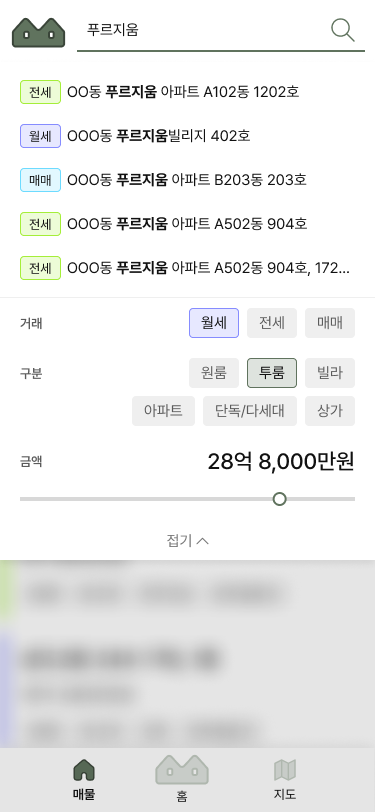
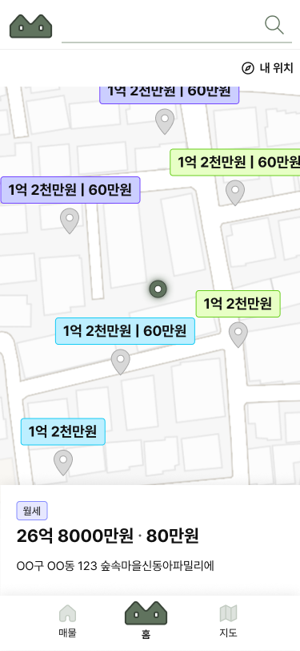
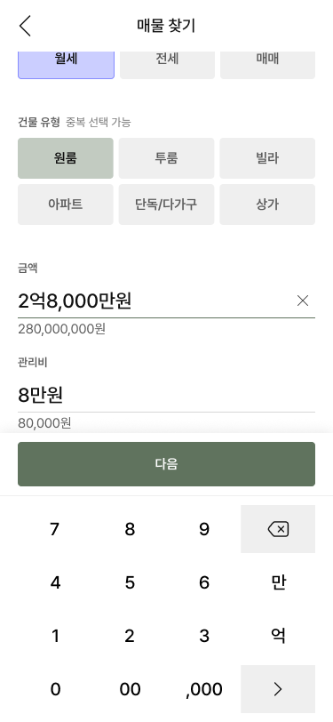
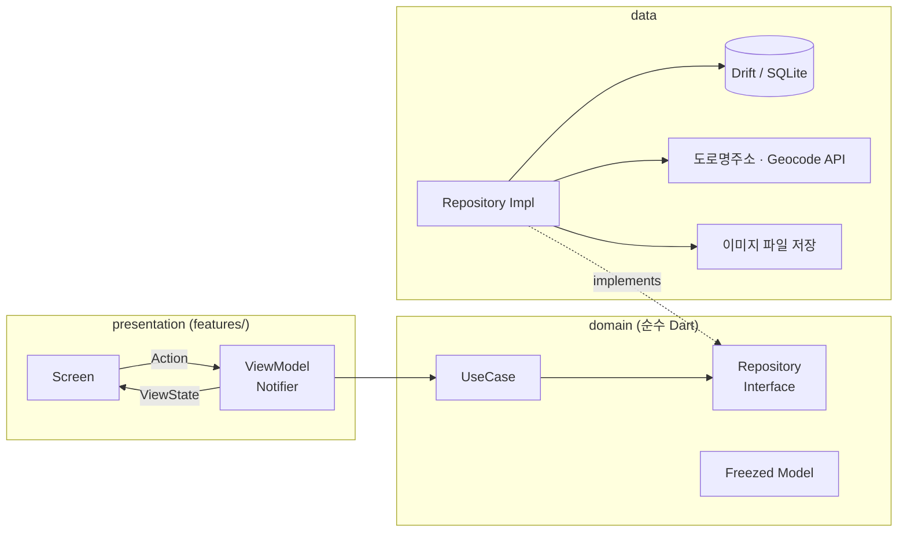

# 넝쿨집사 (Vine Butler)

> 공인중개사를 위한 매물 관리 앱 — 전세·월세·매매 매물을 기기에 저장하고, 조건으로 걸러 보고, 지도에서 위치를 확인합니다.


| 홈 | 매물 검색 · 필터 | 지도 | 매물 등록 |
|:---:|:---:|:---:|:---:|
|  |  |  |  |

<br>

## 프로젝트 소개

공인중개사는 매물 정보를 수첩·엑셀·메신저에 흩어 관리하는 경우가 많습니다.
넝쿨집사는 매물을 한곳에 모으고, **거래 유형·매물 유형·금액 조건으로 바로 찾고, 지도에서 위치를 함께 볼 수 있도록** 만든 앱입니다.

| 항목 | 내용 |
|---|---|
| 개발 기간 | 2026.09 ~ 진행 중 |
| 개발 인원 | 1인 (기획 · 디자인 · 개발 · 배포) |
| 현재 상태 | iOS App Store 1.1.0 / Google Play 비공개 테스트 1.0.0 출시 준비 |

### 목차

- [넝쿨집사 (Vine Butler)](#넝쿨집사-vine-butler)
  - [프로젝트 소개](#프로젝트-소개)
    - [목차](#목차)
  - [주요 기능](#주요-기능)
  - [기술 스택](#기술-스택)
  - [아키텍처](#아키텍처)
  - [기술적 고민과 해결](#기술적-고민과-해결)
    - [1. 매물 탭 첫 진입 시 빈 화면](#1-매물-탭-첫-진입-시-빈-화면)
    - [2. 지도 마커 표시 개수 제한](#2-지도-마커-표시-개수-제한)
  - [멀티 플랫폼 대응](#멀티-플랫폼-대응)
  - [개발 프로세스](#개발-프로세스)
  - [로드맵](#로드맵)
  - [프로젝트 구조](#프로젝트-구조)
  - [실행 방법](#실행-방법)

<br>

## 주요 기능

**매물 관리** — 유형 → 주소 → 집주인 정보 → 추가 정보 단계별 입력
- 도로명주소 API로 주소 검색, 네이버 Geocode API로 좌표 변환하여 지도로 표시
- 기본적인 CRUD 적용

**매물 목록 · 검색** — 거래 유형(전세/월세/매매), 매물 유형, 금액 필터와 키워드 검색
- 거래 유형과 매물 유형에 따른 필터링 적용
- 선택된 금액과 비슷한 순으로 정렬

**지도** — 가격 마커와 마커 선택 시 매물 카드 표시
- 현재 위치 기반 지도 표시
- 화면 범위 안 매물만 zoom별 최대 개수만큼 표시

**AI를 활용한 블로그 글쓰기 기능**
- 매물 상세 정보 + 사진으로 장점을 뽑아 글 생성

**이미지 텍스트 인식(OCR) AI 매물 등록(예정)**
- 메모한 이미지를 사진으로 찍어 업로드하여 매물 정보를 자동으로 기입

**녹음 파일 분석 AI로 매물 등록(예정)**
- 녹음 파일을 업로드하여 매물 등록 정보를 자동으로 기입
<br>

## 기술 스택

| 역할 | 기술 | 선택 이유 |
|---|---|---|
| 상태관리 | Riverpod 3 (`Notifier`) | Provider 단위 의존성 주입과 테스트 시 override가 쉬움 |
| 라우팅 | go_router + go_router_builder | 탭별 화면 스택 유지(`StatefulShellRoute`), 타입 안전한 경로 |
| 로컬 DB | Drift (SQLite) | 타입 안전 쿼리, 스키마 버전·마이그레이션 관리 |
| 도메인 모델 | Freezed | 불변 모델, `copyWith`·값 비교 자동 생성 |
| 네트워크 | Dio | 인터셉터로 API별 인증 헤더 분리 |
| 지도 | flutter_naver_map / webview_flutter / webview_windows | 모바일: 네이버 지도 SDK, 데스크톱: 웹뷰 + 네이버 지도 JS |
| 위치 | geolocator | 현재 위치 기반 지도 표시 |

<br>

## 아키텍처

Repository 패턴 + MVVM 기반으로, 클린 아키텍처를 단계적으로 도입하고 있습니다.



**레이어 의존성 규칙**
- `presentation` → `domain` 인터페이스만 참조 (구현체 직접 참조 금지)
- `data` → `domain` 인터페이스를 구현
- `domain`은 Flutter·Drift에 의존하지 않는 순수 Dart
- 구현체는 `core/di/providers.dart`에서 인터페이스 타입으로 노출

**VM 패턴** — 화면 이벤트는 `sealed class` Action 하나로 받아 처리 흐름을 한곳에 모음

```dart
sealed class PropertyListAction {
  const factory PropertyListAction.search(String query) = _Search;
  const factory PropertyListAction.filtering(PropertyFilterData data) = _Filtering;
  ...
}

ref.read(propertyListVMProvider.notifier).action(PropertyListAction.search(query));
```

**공통 컴포넌트** — `lib/components/`를 앱과 분리된 모듈처럼 관리
- Figma 변수와 맞춘 디자인 토큰(컬러·타이포·아이콘)
- 버튼, 텍스트필드, 바텀시트, 토스트, 키패드 등 30여 개 위젯
- 각 위젯은 `ViewState` + 콜백만 받고 앱 상태·`core`를 import하지 않음

<br>

## 기술적 고민과 해결

결정마다 대안 비교와 측정 결과를 [ADR](docs/adr/)로 기록합니다.

### 1. 매물 탭 첫 진입 시 빈 화면

| | |
|---|---|
| **문제** | 앱을 켜고 매물 탭에 처음 들어가면 약 **0.27~0.33초** 빈 화면이 보임 |
| **원인** | 매물 탭이 만들어지는 순간 처음으로 DB에 접근 → 백그라운드 isolate 생성·DB 열기가 이 시점에 몰림 |
| **검토한 대안** | ① 로딩 인디케이터 ② 스플래시에서 DB 로딩 후 진입 ③ `runApp` 직후 뒷단에서 미리 로딩 |
| **해결** | ③ 선택. `ProviderContainer`를 직접 만들어 `UncontrolledProviderScope`로 넘기고, `runApp` 직후 매물 목록 VM을 미리 읽음 |
| **결과** | 홈 화면이 뜨고 **0.3초 뒤부터 매물 탭을 열면 빈 화면 0ms**. 앱 시작 시간은 늘지 않음 |

②는 측정해 보니 홈 화면이 0.1~0.5초 늦어지고, 한 회차는 5.6초까지 늘어나 제외했습니다.

→ [ADR 0001: 매물 목록 미리 로딩](docs/adr/0001-preload-property-list.md)

### 2. 지도 마커 표시 개수 제한

| | |
|---|---|
| **문제** | 매물 100개 기준 지도 첫 화면에 마커가 보이기까지 **약 2.1~2.7초** |
| **원인** | 필터에 맞는 매물을 전부 마커로 만들고, 마커마다 라벨 + 핀 이미지 2장을 그림. 화면 밖 매물까지 그려 확대해도 비용이 같음 |
| **해결** | 카메라가 멈출 때마다 화면 범위를 상하좌우 50% 넓힌 영역의 매물만 고르고, zoom별 최대 개수(10 / 15 / 20 / 제한 없음)를 넘으면 카메라 중심과 가까운 순으로 남김. 이미 그린 마커는 재사용하고 새 마커만 그림 |
| **결과** | 첫 화면 **2.1~2.7초 → 0.4~0.8초**, 메모리 **약 64~91MB 감소**, zoom 변경 시 갱신 10~26ms |

측정 중 지도 첫 진입 시 앱이 죽는 문제(`flutter_naver_map` 임시 폴더 초기화 경쟁 조건)를 발견해, 앱 시작 때 내 위치 아이콘을 미리 준비하도록 함께 수정했습니다.

→ [ADR 0002: zoom별 마커 개수 제한](docs/adr/0002-map-marker-limit-by-zoom.md)

<br>

## 멀티 플랫폼 대응

| 플랫폼 | 지도 구현 | 최소 버전 |
|---|---|---|
| iOS | 네이버 지도 SDK (`flutter_naver_map`) | iOS 15.0 |
| Android | 네이버 지도 SDK (`flutter_naver_map`) | Android 7.0 |
| macOS | `webview_flutter` + 네이버 지도 JS | macOS 12.0 |
| Windows | `webview_windows` + 네이버 지도 JS | Windows 10 |

- 지도 위젯을 `native_map` / `mac_map` / `windows_map`으로 분리하고 같은 `ViewState`를 받도록 맞춤
- 웹뷰 지도는 JavaScript 채널 메시지(`marker:<id>`, `map`, `ready`)로 Flutter와 통신

<br>

## 개발 프로세스
**결정 기록 (ADR)** — 성능·구조 결정을 [MADR](https://adr.github.io/madr/) 형식으로 기록

**브랜치 · PR** — 기능별 브랜치 → PR → merge commit, 커밋 메시지는 `type: 한글 설명`

**배포 스크립트** — `tool/build.dart`
- API 키 파일(`env.json`) 필수 키와 Android 서명 설정을 검사한 뒤 빌드
- 키 누락으로 지도·주소 검색이 동작하지 않는 빌드가 스토어에 올라가는 것을 막음

**출시 관리** — 버전별 체크리스트로 개인정보처리방침, 권한 문구, 스토어 개인정보 라벨 변경 사항 관리

<br>

## 로드맵

로컬 앱으로 먼저 MVP를 출시해 실사용 피드백을 받고, 데스크톱 → AI API 기능 연동 → 백엔드 순으로 확장합니다.

| 버전 | 상태 | 내용 |
|---|---|---|
| 1.0.0 | App Store 출시, Play Console 심사 진행 중 | 매물 등록·검색·상세·지도, 로컬 저장, iOS·Android 스토어 출시 |
| 1.1.0 | App Store 출시 | 금액 입력 키패드, 사진 크게 보기, 현재 위치 기준 지도, zoom별 마커 제한 |
| 1.2.0 | 예정 | 데스크톱 UI, macOS·Windows 배포, Windows 자동 업데이트 |
| 1.3.0 | 예정 | (데스크톱) 사진·녹음 파일 AI 분석으로 매물 등록, 매물 소개 블로그 글 AI 작성 |
| 2.0.0 | 예정 | 백엔드 연동, 회원가입·로그인, 서버 저장, 인앱결제 |
| 2.1.0 | 예정 | 로컬 ↔ 서버 데이터 동기화 |
| 2.2.0 | 예정 | 1.3.0 AI 기능 모바일 적용 |
| 2.3.0 | 예정 | 관리자 권한용 외부 매물 데이터 표시 |

**미리 준비해 둔 설계**
- **AI 기능(1.3.0)** — API 키를 앱에 넣지 않고 서버리스 프록시 + 초대 코드로 호출, 2.0.0에서 백엔드 구현체로 교체
- **백엔드 전환(2.0.0)** — Repository 인터페이스 뒤에 구현체를 두어, 로컬 → 원격 전환 시 presentation 코드 수정 없음
- - **서버 동기화(2.1.0)** — 1.0.0부터 UUID 기본키, `updatedAt`, `deletedAt`, `syncedAt`을 저장해 `syncedAt == null || updatedAt > syncedAt`이면 동기화 대상으로 판단
<br>

## 프로젝트 구조

```
lib/
  core/          # 라우터, DI(Provider), 네트워크(Dio·인터셉터)
  domain/        # 모델(Freezed), Repository 인터페이스, UseCase
  data/          # Drift DB, 외부 API·DTO, 이미지 저장, Mapper, Repository 구현체
  features/      # 기능별 ViewModel + presentation(ViewState, screens)
  components/    # 디자인 토큰, 공통 위젯
  shared/        # 확장, 포맷터 등 유틸
test/            # domain / data / features / components / shared
tool/build.dart  # 스토어 업로드용 빌드 스크립트
docs/adr/        # 아키텍처 결정 기록
```

<br>

## 실행 방법

프로젝트 루트에 `env.json`을 만들고 API 키를 넣습니다.

```json
{
  "NAVER_MAPS_CLIENT_ID": "",
  "NAVER_MAPS_CLIENT_SECRET": "",
  "JUSO_CONFM_KEY": ""
}
```

```bash
flutter pub get
flutter run --dart-define-from-file=env.json
```

```bash
flutter test
```
